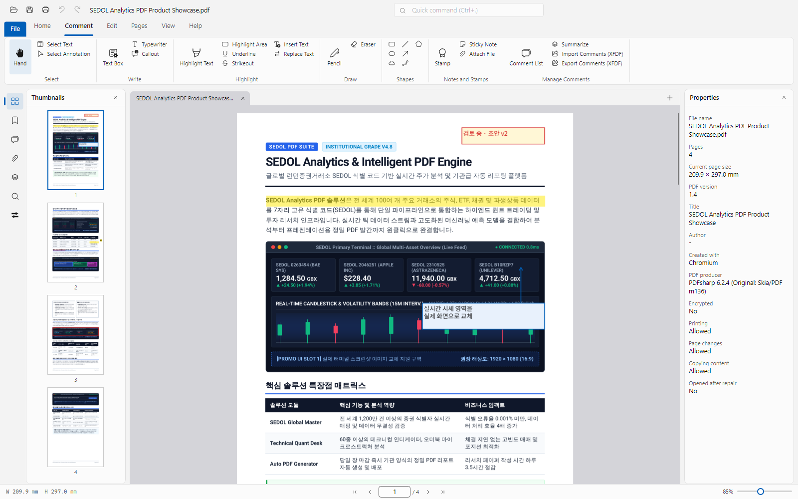
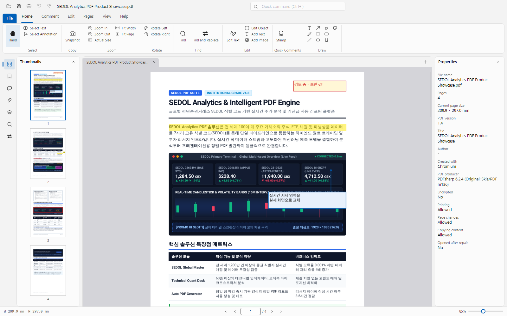
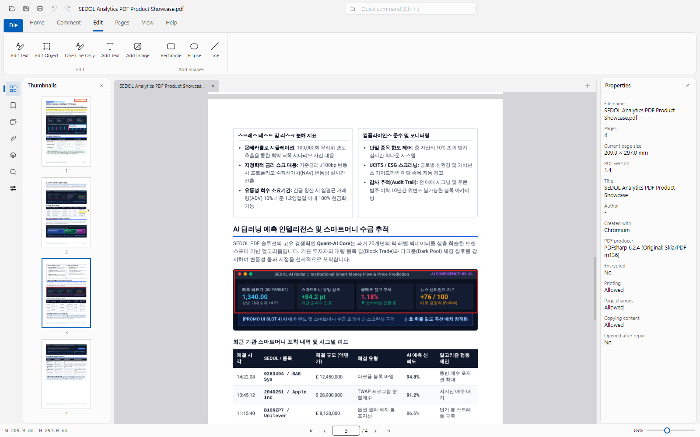
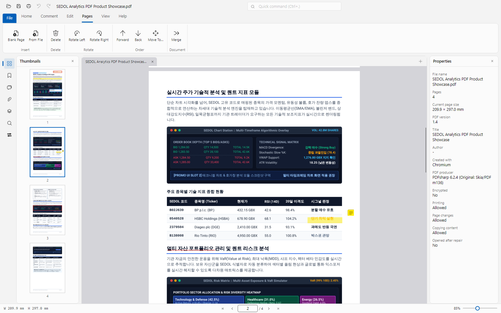
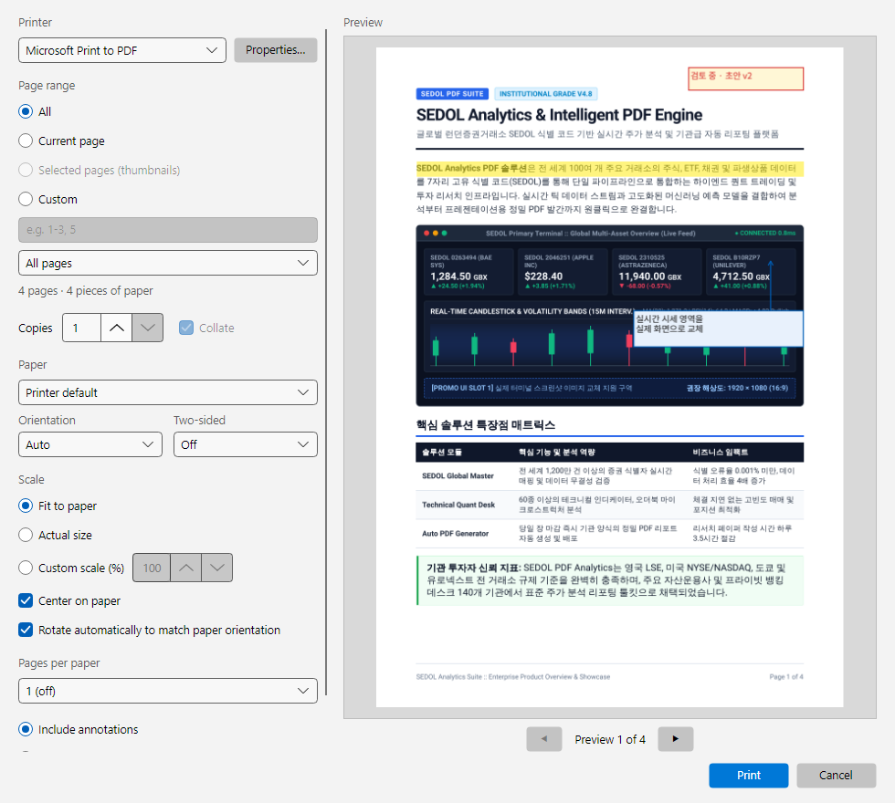
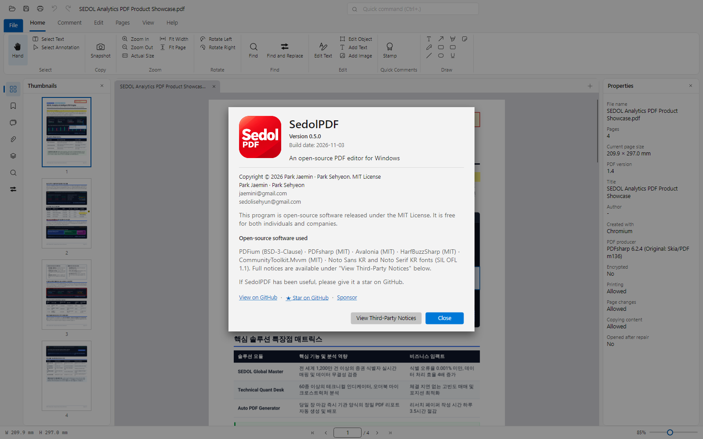

# SedolPDF

**English** · [한국어](README.md)

A free, open-source PDF editor for Windows. View, annotate, edit pages, and edit text, images and shapes directly in one app. Free for personal and commercial use (MIT License).

> **This is an early public release (v0.10.0).** The core features work, but it is still being polished. Keep a backup of important files. Please report problems and ideas in [Issues](https://github.com/jaeminiz/SedolPDF/issues). **The interface is available in Korean and English.**

<p align="center">

[](https://github.com/jaeminiz/SedolPDF/releases/latest)   

[](https://apps.microsoft.com/detail/9NV1D7TDKVJK)

[Installer & portable ZIP](https://github.com/jaeminiz/SedolPDF/releases/latest) · [Issues](https://github.com/jaeminiz/SedolPDF/issues)

</p>



## Features

**Viewing**
- Tile-based rendering so large CAD-style drawings open quickly (goal: first screen of an A1 drawing within 0.5 s; a 300-page document under 400 MB of memory).
- Continuous and single-page view, zoom, actual size (100% = 96 dpi), fit width/page, hold Space or press the mouse wheel button and drag to pan (hand tool).
- Text selection and copy, search, thumbnail / bookmark / attachment / layer panels, snapshot (copy a region or a whole page as an image).

**Annotations**
- Sticky note, highlight / underline / strikeout, text box, typewriter, callout, line, arrow, polyline, polygon, cloud, rectangle, ellipse, pencil, eraser, stamps (built-in and image), file attachment, text insert / replace.
- Comment list, replies, review status, saved styles, annotation summary PDF, XFDF import / export (exchange annotations with other PDF tools).
- Korean annotation text is saved so that it displays correctly in other viewers.
- Rectangles and ellipses with a rect-difference margin (`/RD`) and typewriter text annotations made by other PDF tools can now be selected and edited.

**Page editing**
- Insert blank pages or pages from another file, delete, rotate, reorder, merge, extract pages, drag PDFs in to insert. Everything is undoable.

**Text and object editing**
- Edit an existing line of text: the original font is kept when that is verifiably safe; otherwise the line is rewritten with the bundled Noto Sans KR.
- Fixed text disappearing from bold text made by overprinting the same text. Editable text pieces are previewed as boxes, the in-place editor is translucent so you edit right over the original, and edited text keeps the original weight, color and size.
- Text format: see and change font, size, color, bold, italic and serif in the properties panel.
- Move, resize and delete images and shapes; add new text, images and shapes; multi-select.
- Copy and paste objects and annotations (Ctrl+C/X/V/D) within a document, with a right-click menu; multiple items at once, one undo.

**Reducing file size**
- File → Save in another format → Save with reduced size: enter a target size (MB) and the images are recompressed into a new file at or below it (for email; default 16 MB). Text, vector graphics and annotations are untouched (black-and-white scans are recompressed with JBIG2). Up to 5% over the target is accepted. If the target cannot be met, one dialog lets you choose between saving as is, converting to color images, or drawing mode (lines and text kept as a high-resolution black-and-white layer with color added at low resolution; high, medium or lowest quality), with the expected size of each shown up front. Converting removes text, links and annotations. The original is never changed.

**Tabs**
- Right-click a tab for Open containing folder, Copy full path and Close this tab.
- Multiple windows: File → New Window (Ctrl+Shift+N). Drag a tab out of the window to open it in a new window, or drop it on another window's tab row to move it there (Esc cancels). Move to new window and Move to another window on the tab's right-click menu do the same. Unsaved edits and undo history move with the tab.
- Pages damaged by saves in 0.8.0 and earlier are repaired on save (with a notice and a Reopen button); text boxes are compatible with Acrobat (font size and border colour kept both ways); rotate annotations with the green handle (Shift = 15°, boxes snap to 90°); the object image follows while dragging
- Copy, cut, paste and duplicate objects (Ctrl+C/X/V/D, right-click menu, within the same document), copy/paste annotations (including area highlight), drag-to-rotate objects (Shift = 15°, angle shown), zoom 1% to 6400%

**Safety**
- Saving writes a temporary file, verifies it, then replaces the original. Unknown annotation keys are preserved.
- Auto-recovery after a crash, and opening password-protected PDFs.
- The application code makes no network connections.











## Install

**[Get it from the Microsoft Store](https://apps.microsoft.com/detail/9NV1D7TDKVJK)** — updates automatically and has no SmartScreen warning. Search for "SedolPDF" in the Store. New versions go through Store review, so they can arrive a few days after GitHub.

Or download from [Releases](https://github.com/jaeminiz/SedolPDF/releases).

| File | Description |
|---|---|
| `SedolPDF-<version>-setup-win-x64.exe` | Installer (per-user) |
| `SedolPDF-<version>-portable-win-x64.zip` | Portable: extract and run `SedolPDF.exe`. Settings are stored in the `data` folder next to it |

- Windows 10/11, 64-bit.
- The binaries are not code-signed, so Windows SmartScreen may show an "unknown publisher" warning on first run. All source code is in this repository, and `SHA256SUMS.txt` in the release lets you verify the files.

## Build from source

You need the [.NET SDK 10](https://dotnet.microsoft.com/download) and PowerShell 7.

```bash
dotnet build PdfEditor.sln -c Release
dotnet test PdfEditor.sln          # 1,100+ tests
pwsh build/package.ps1             # build the portable zip and installer (see build/README.md)
```

## Limitations and plans

- The user interface is available in Korean and English (from v0.4.0; change it in Preferences, applied after a restart). Long-form documentation and design documents are Korean only for now.
- Not available yet: paragraph-level editing (reflowing several lines), digital signatures, form editing, OCR, measurement tools, dark mode.
- Pictures and text inside a grouped drawing block (form XObject) can only be moved or deleted as a whole.
- Rendering in other PDF viewers is still being verified. Please report odd files via Issues (do not attach personal or company documents).

## Technology

C# / .NET 10, [Avalonia](https://avaloniaui.net) 12 (Fluent), [PDFium](https://pdfium.googlesource.com/pdfium/) (direct P/Invoke wrapper), [PDFsharp](https://github.com/empira/PDFsharp) 6.2, HarfBuzzSharp, Noto Sans KR. Design documents are in `docs/superpowers/specs/` (Korean) and validation results in `docs/validation/`.

## License

[MIT](LICENSE). Notices for the open-source components used (PDFium BSD-3-Clause; PDFsharp, Avalonia, HarfBuzzSharp MIT; Noto Sans KR OFL 1.1) are in [THIRD-PARTY-NOTICES.md](THIRD-PARTY-NOTICES.md).

## Support

SedolPDF has no ads and no paid features. If it is useful to you, you can optionally support it through [GitHub Sponsors](https://github.com/sponsors/jaeminiz).

## Authors

Park Jaemin ([jaemini@gmail.com](mailto:jaemini@gmail.com)) · Park Sehyeon ([sedolisehyun@gmail.com](mailto:sedolisehyun@gmail.com))
