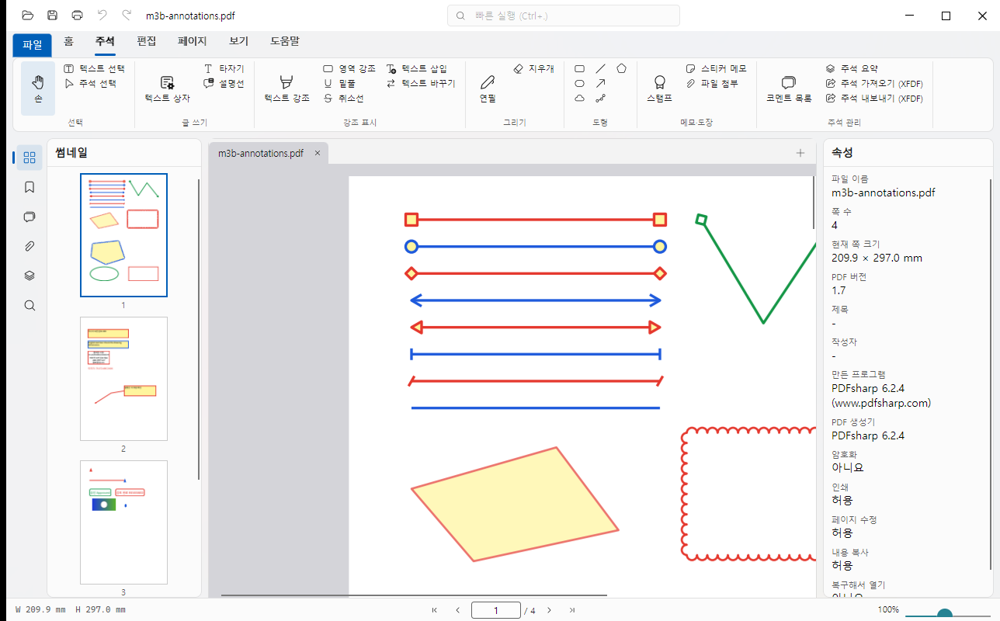
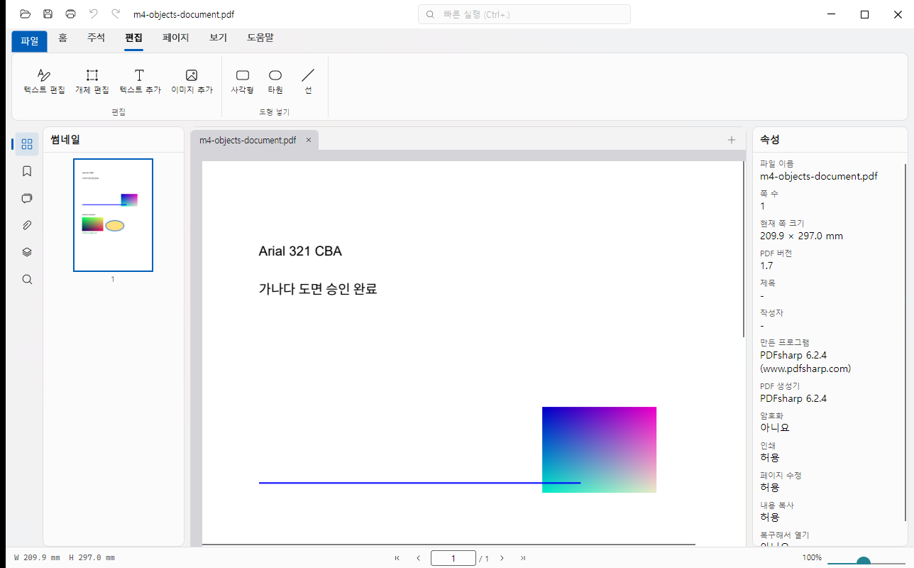

# SedolPDF

**English** · [한국어](README.md)

A free, open-source PDF editor for Windows. View, annotate, edit pages, and edit text, images and shapes directly in one app. Free for personal and commercial use (MIT License).

> **This is an early public release (v0.2.0).** The core features work, but it is still being polished. Keep a backup of important files. Please report problems and ideas in [Issues](https://github.com/jaeminiz/SedolPDF/issues). **The user interface is in Korean only for now.**



## Features

**Viewing**
- Tile-based rendering so large CAD-style drawings open quickly (goal: first screen of an A1 drawing within 0.5 s; a 300-page document under 400 MB of memory).
- Continuous and single-page view, zoom, actual size (100% = 96 dpi), fit width/page, hold Space to pan (hand tool).
- Text selection and copy, search, thumbnail / bookmark / attachment / layer panels, snapshot (copy a region or a whole page as an image).

**Annotations**
- Sticky note, highlight / underline / strikeout, text box, typewriter, callout, line, arrow, polyline, polygon, cloud, rectangle, ellipse, pencil, eraser, stamps (built-in and image), file attachment, text insert / replace.
- Comment list, replies, review status, saved styles, annotation summary PDF, XFDF import / export (exchange annotations with other PDF tools).
- Korean annotation text is saved so that it displays correctly in other viewers.

**Page editing**
- Insert blank pages or pages from another file, delete, rotate, reorder, merge, extract pages, drag PDFs in to insert. Everything is undoable.

**Text and object editing**
- Edit an existing line of text: the original font is kept when that is verifiably safe; otherwise the line is rewritten with the bundled Noto Sans KR.
- Move, resize and delete images and shapes; add new text, images and shapes; multi-select.

**Safety**
- Saving writes a temporary file, verifies it, then replaces the original. Unknown annotation keys are preserved.
- Auto-recovery after a crash, and opening password-protected PDFs.
- The application code makes no network connections.



## Install

Download from [Releases](https://github.com/jaeminiz/SedolPDF/releases).

| File | Description |
|---|---|
| `SedolPDF-<version>-setup-win-x64.exe` | Installer (per-user) |
| `SedolPDF-<version>-portable-win-x64.zip` | Portable: extract and run `SedolPDF.exe`. Settings are stored in the `data` folder next to it |

- Windows 10/11, 64-bit.
- The binaries are not code-signed, so Windows SmartScreen may show an "unknown publisher" warning on first run. All source code is in this repository, and `SHA256SUMS.txt` in the release lets you verify the files.

## Build from source

You need the [.NET SDK 10](https://dotnet.microsoft.com/download) and PowerShell 7.

```bash
dotnet build PdfEditor.sln -c Release
dotnet test PdfEditor.sln          # 1,100+ tests
pwsh build/package.ps1             # build the portable zip and installer (see build/README.md)
```

## Limitations and plans

- The user interface is Korean only.
- Not available yet: paragraph-level editing (reflowing several lines), digital signatures, form editing, OCR, measurement tools, dark mode.
- Pictures and text inside a grouped drawing block (form XObject) can only be moved or deleted as a whole.
- Rendering in other PDF viewers is still being verified. Please report odd files via Issues (do not attach personal or company documents).

## Technology

C# / .NET 10, [Avalonia](https://avaloniaui.net) 12 (Fluent), [PDFium](https://pdfium.googlesource.com/pdfium/) (direct P/Invoke wrapper), [PDFsharp](https://github.com/empira/PDFsharp) 6.2, HarfBuzzSharp, Noto Sans KR. Design documents are in `docs/superpowers/specs/` (Korean) and validation results in `docs/validation/`.

## License

[MIT](LICENSE). Notices for the open-source components used (PDFium BSD-3-Clause; PDFsharp, Avalonia, HarfBuzzSharp MIT; Noto Sans KR OFL 1.1) are in [THIRD-PARTY-NOTICES.md](THIRD-PARTY-NOTICES.md).

## Authors

Park Jaemin ([jaemini@gmail.com](mailto:jaemini@gmail.com)) · Park Sehyeon ([sedolisehyun@gmail.com](mailto:sedolisehyun@gmail.com))
