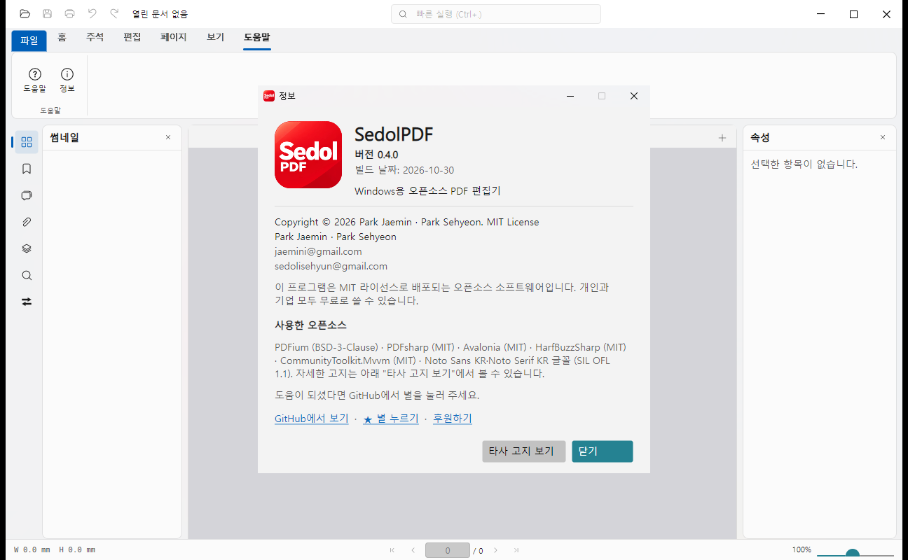

# SedolPDF (세돌PDF)

[English](README.en.md) · **한국어**

Windows용 무료 오픈소스 PDF 편집기입니다. 보기, 주석, 쪽 편집, 텍스트·이미지·도형 직접 편집을 한 프로그램에서 하고, 개인과 기업 모두 무료로 쓸 수 있습니다(MIT 라이선스).

> **초기 공개 버전(v0.4.0)입니다.** 기본 기능은 쓸 수 있지만 아직 다듬는 중입니다. 중요한 파일은 원본을 따로 보관하고 쓰세요. 문제나 제안은 [Issues](https://github.com/jaeminiz/SedolPDF/issues)에 남겨 주세요.


## 주요 기능

**보기**
- 큰 CAD 도면 PDF도 빠르게 열리도록 타일 방식으로 그립니다(A1 크기 도면 첫 화면 0.5초 이내 목표, 300쪽 문서도 메모리 400 MB 미만 목표).
- 연속·한 쪽 보기, 확대·축소, 실제 크기(100% = 96dpi), 폭·쪽 맞춤, 스페이스바로 이동(손 도구).
- 텍스트 선택·복사, 찾기, 썸네일·책갈피·첨부·레이어 패널, 스냅숏(영역 또는 쪽 전체를 그림으로 복사).

**주석**
- 스티커 메모, 형광펜·밑줄·취소선, 텍스트 상자·타자기·설명선, 선·화살표·폴리라인·다각형·구름·사각형·타원, 연필·지우개, 스탬프(기본 + 그림), 파일 첨부, 텍스트 삽입·바꾸기.
- 코멘트 목록, 답글, 검토 상태, 스타일 저장·적용, 주석 요약 PDF, XFDF 가져오기·내보내기(다른 PDF 프로그램과 주석 주고받기).
- 한글 주석을 다른 뷰어에서도 깨지지 않게 저장합니다.

**쪽 편집**
- 빈 쪽·파일에서 쪽 넣기, 삭제, 회전, 순서 바꾸기, 합치기, 쪽 추출, PDF를 끌어다 놓아 넣기. 모두 실행 취소를 지원합니다.

**텍스트·객체 편집**
- 기존 텍스트 한 줄 고치기: 원래 글꼴로 안전하게 쓸 수 있으면 그대로 쓰고, 아니면 앱에 포함된 Noto Sans KR로 바꿉니다.
- 이미지·도형 옮기기, 크기 바꾸기, 지우기, 새 텍스트·이미지·도형 넣기, 여러 개 선택.

**안전**
- 저장은 임시 파일에 쓰고 검증한 뒤 원본과 교체합니다. 알 수 없는 주석 키는 보존합니다.
- 자동 복구(비정상 종료 뒤 편집 내용 복구), 암호가 걸린 PDF 열기.
- 앱 코드에는 네트워크 통신이 없습니다.




## 설치

[Releases](https://github.com/jaeminiz/SedolPDF/releases)에서 받으세요.

| 파일 | 설명 |
|---|---|
| `SedolPDF-<버전>-setup-win-x64.exe` | 설치 파일(현재 사용자용) |
| `SedolPDF-<버전>-portable-win-x64.zip` | 포터블 버전. 압축을 풀고 `SedolPDF.exe` 실행. 설정은 같은 폴더의 `data`에 저장 |

- Windows 10/11 64비트에서 동작합니다.
- 코드 서명을 하지 않아 처음 실행할 때 Windows SmartScreen이 "알 수 없는 게시자" 경고를 띄울 수 있습니다. 소스는 이 저장소에 모두 공개되어 있고, 릴리스에 올린 `SHA256SUMS.txt`로 파일을 확인할 수 있습니다.

## 직접 빌드

필요한 것: [.NET SDK 10](https://dotnet.microsoft.com/download), PowerShell 7.

```bash
dotnet build PdfEditor.sln -c Release
dotnet test PdfEditor.sln          # 1100개 이상의 시험
pwsh build/package.ps1             # 포터블 zip과 설치 파일 만들기 (build/README.md 참고)
```

## 한계와 계획

- 화면 언어는 한국어와 영어입니다(0.4.0부터, 환경 설정에서 바꾸면 다시 시작한 뒤 적용). 긴 설명서·개발 문서는 아직 한국어뿐입니다.
- 아직 없는 기능: 문단 단위 편집(여러 줄 다시 맞추기), 전자서명, 양식 편집, OCR, 측정 도구, 다크 모드.
- 묶음(폼) 안에 든 그림·글자는 묶음 전체로만 옮기거나 지울 수 있습니다.
- 다른 PDF 프로그램에서의 모양은 계속 확인 중입니다. 이상한 파일은 Issues로 알려 주세요(개인·회사 문서는 올리지 마세요).

## 기술

C# / .NET 10, [Avalonia](https://avaloniaui.net) 12(Fluent), [PDFium](https://pdfium.googlesource.com/pdfium/)(P/Invoke 직접 래핑), [PDFsharp](https://github.com/empira/PDFsharp) 6.2, HarfBuzzSharp, Noto Sans KR. 설계서는 `docs/superpowers/specs/`, 검증 결과는 `docs/validation/`에 있습니다.

## 라이선스

[MIT](LICENSE). 사용한 오픈소스(PDFium BSD-3-Clause, PDFsharp·Avalonia·HarfBuzzSharp MIT, Noto Sans KR OFL 1.1)의 고지는 [THIRD-PARTY-NOTICES.md](THIRD-PARTY-NOTICES.md)에 있습니다.

## 후원

SedolPDF는 광고도 유료 기능도 없습니다. 도움이 되셨다면 [GitHub Sponsors](https://github.com/sponsors/jaeminiz)로 응원해 주실 수 있습니다(선택).

## 만든 사람

Park Jaemin ([jaemini@gmail.com](mailto:jaemini@gmail.com)) · Park Sehyeon ([sedolisehyun@gmail.com](mailto:sedolisehyun@gmail.com))
